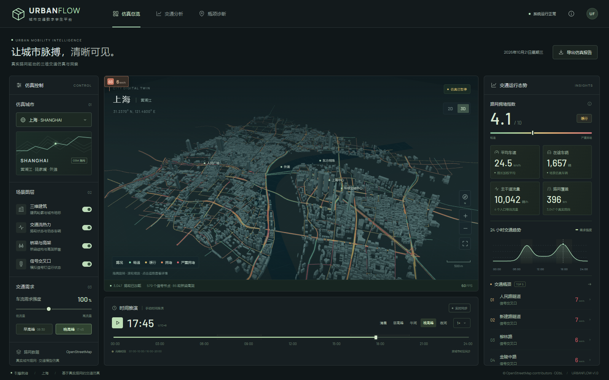

# URBANFLOW · 城市交通数字孪生

基于 **真实 OpenStreetMap 路网 + Three.js 三维场景 + 时间驱动交通模型** 的城市道路交通仿真系统。面向桌面设计，也支持手机和平板。



[东京场景](docs/tokyo.png) · [移动端预览](docs/mobile.png)

## 开始使用

需要 **Node.js 20.19+**（推荐 Node.js 22 或 24）和支持 WebGL 2 的现代浏览器。

```bash
npm ci
npm run dev
```

打开终端输出的本地地址，通常为 **http://127.0.0.1:5173/**。首次安装需要网络；四座城市的路网快照随项目提供，运行期间无需地图 API Key 或 Overpass 网络连接。在线字体不可用时自动使用系统字体。

推荐体验路径：选择「上海」→「晚高峰」→点击地图瓶颈标记 → 调整车流需求 → 切换到「交通分析」查看全天趋势与高峰对比。

## 已实现

- **四城切换**：上海、纽约、伦敦、东京，包含各自的真实道路坐标、名称、单行方向、车道和自由流速度信息。
- **3D 城市场景**：真实建筑轮廓、概化城市地标与水域、道路层级、桥梁、高架桥墩和立交匝道。支持旋转、平移、缩放、俯视、复位与全屏。
- **动态交通**：车辆沿路网运行，按节点选择后续道路，遵守单行约束；包含车距约束与模拟信号灯排队。
- **当地时间同步**：各城市使用 IANA 时区，自动处理夏令时；可以手动拖动全天时间轴，或选择清晨、早高峰、午间、晚高峰、夜间。
- **仿真回放**：暂停/播放，1×、5×、15×、60×；手动回放 1× 表示每秒推进 1 分钟。实时同步模式跟随城市时钟，回放速度只影响手动推演。
- **需求实验**：40%–180% 交通需求调节，影响车流、速度、拥堵程度及可视化车辆数。
- **同源分析看板**：路长加权速度、拥堵指数、实际场景车辆数、等效主干道流量、24 小时需求趋势、道路状态分布与高峰对比。
- **瓶颈诊断**：命名道路 TOP 5、地图瓶颈标记、路段详情和相机定位；没有拥堵时明确显示相对缓慢路段。
- **CSV 报告**：导出当前城市全部路段的 OSM ID、名称、道路类型、车道、长度、速度、流量、拥堵指数和额外行驶延误。包含 UTF-8 BOM，可直接用 Excel 打开。
- **交互与容错**：响应式布局、键盘操作、图层开关、加载状态、可恢复的数据错误和 WebGL 不可用提示。

## 真实路网范围

内置的是著名城市的**核心城区**，并非全市道路。OSM 查询会包含与范围相交的完整道路，因此边缘道路可能延伸到区域外。统计中的路段在共享节点或信号节点处分割。

| 城市 | 主要区域 | 路段 | 路长约 km | 信号节点 | 桥梁 / 高架路段 |
| --- | --- | ---: | ---: | ---: | ---: |
| 上海 | 外滩、陆家嘴、黄浦江 | 3,047 | 396 | 579 | 86 |
| 纽约 | 曼哈顿下城、布鲁克林大桥、曼哈顿大桥 | 4,194 | 296 | 1,123 | 145 |
| 伦敦 | 金融城、伦敦桥、塔桥、泰晤士河 | 9,085 | 320 | 1,253 | 78 |
| 东京 | 东京站、日本桥、皇居、首都高速 | 5,969 | 393 | 800 | 275 |

快照下载日期：**2026-10-21（北京时间）**。原始 OSM 时间戳与查询边界保存在各城市 JSON 中。

```bash
npm run data:stats             # 检查内置路网统计
npm run data:refresh           # 从 Overpass 依次更新四城，需要网络
npm run data:refresh -- tokyo  # 只更新东京
```

下载器按顺序使用多个公共 Overpass 端点。下载失败时保留原有快照；公共服务可能限流，稍后重试即可。`scripts/compact-osm.mjs` 去除无关标签并将经纬度保留到小数点后 6 位，保留道路节点、原始 OSM ID 和交通相关属性。

地图数据 © [OpenStreetMap contributors](https://www.openstreetmap.org/copyright)，遵循 [ODbL 1.0](https://opendatacommons.org/licenses/odbl/1-0/)。更多来源与表达说明见 [DATA.md](docs/DATA.md)。

## 交通模型与指标

系统采用简化、可复现的教学仿真。交通状态不是导航平台实测路况，**「实时同步」指同步当地时间**。

1. **需求**：凌晨基线叠加早高峰 08:30、晚高峰 17:45 与午间需求的高斯曲线，再乘以用户需求强度。
2. **容量约束**：按路段类型、桥梁、匝道、信号节点与确定性路段系数形成需求 / 容量比 `r`。
3. **速度**：BPR 形式 `v = max(4, v_free / (1 + 0.22 × r⁴) − 信号延误项)`，单位 km/h。自由流速度优先读取 OSM `maxspeed`，支持 mph 转换，缺失时按道路等级设默认值。
4. **车辆**：从同一模型获得行驶速度，沿折线路径插值，处理最小车距、单向行驶、70 秒模拟信号周期和相邻道路续行。边界与死路处重新注入车辆。
5. **拥堵指数**：`10 × Σ[路长 × (1 − v / v_free)] / 总路长`。0–2.2 畅通，2.2–4.3 缓行，4.3–6.7 拥堵，6.7–10 严重拥堵。
6. **瓶颈**：按每条命名道路最拥堵的路段排序；局部拥堵与全局平均可能不同。路段延误为当前速度相对自由流产生的额外行驶秒数。
7. **流量**：由容量与需求比估算；主干道卡片为主干道路段平均流量 × 4 个等效入口，不是城区断面实测总和。

场景最多绘制 **6,500 栋建筑**与 **2,200 辆车**。建筑高度缺失时使用可复现估计；地标、水域、桥梁高架高度为概化表达。模型没有以实际 OD、历史流量或真实信号配时校准，不包含公共交通调度、行人互动、转向相位控制或事故预测。

## 验证与构建

```bash
npm test                 # 10 项路网 / 模型 / 时区测试
npm run build            # 输出 dist/
npx playwright install chromium  # 首次运行浏览器测试时安装；Windows 默认使用系统 Edge
npm run test:e2e          # 7 项端到端场景测试，使用生产构建预览
npm run preview          # 本地查看生产版本
```

端到端验证覆盖：四城切换、渲染与数据一致性、高峰和需求响应、暂停、午夜边界、当地时间同步、四个图层、2D/3D、缩放、瓶颈定位、诊断与说明弹窗、CSV 下载、手机布局、数据失败后的城市恢复，以及 WebGL 不支持时的提示。

Windows 使用系统 Edge；Linux / macOS 使用 Playwright Chromium。可通过 `BROWSER_CHANNEL` 覆盖浏览器 channel。GitHub Actions 会执行模型测试、生产构建和浏览器测试，并上传验收截图与失败追踪。

`dist/` 可部署到任意静态站点服务。构建使用相对资源路径，可放在域名根目录或 `/my-traffic-simulation/` 等子目录下。必须通过 HTTP 服务访问，不能直接双击 HTML 文件。

## 工程结构

```text
src/
  cities.js        城市、时区和地理坐标投影
  simulation.js    路网图、交通需求、BPR、车辆与指标
  scene.js         Three.js 场景、相机、实例化车辆与拾取
  charts.js        SVG 趋势图与道路状态分布
  icons.js         本地 SVG 图标
  main.js          控制、看板、诊断、导出与加载流程
  style.css        桌面 / 平板 / 手机布局
public/data/       四城 OSM 离线快照
scripts/           数据获取、精简和统计
tests/             模型与浏览器回归
docs/              数据来源与界面截图
```
